# Штурман 38 · игра-навигатор для начинающих водителей (Иркутск)

> Сначала услышал маршрут — потом спокойно поехал.

**Штурман 38** — веб-игра для выпускников автошкол Иркутска. Новичок строит маршрут по городу, машинка проезжает его сама, а штурман голосом рассказывает каждый поворот, светофор и ориентир. Потом новичок едет сам: перед перекрёстками выбирает полосу и направление, получает очки, уровни и место в рейтинге.

Вокруг маршрутов — раздел «Учёба»: все дорожные знаки, разметка, светофоры и регулировщик, памятка при ДТП, зимние советы для Иркутска и ежедневная тренировка. Для автошкол есть панель, где преподаватели видят успехи и ошибки своих учеников.

<p>
  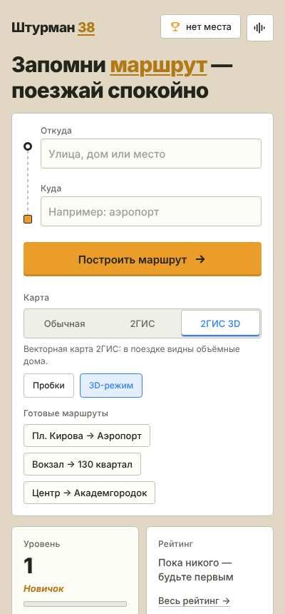
  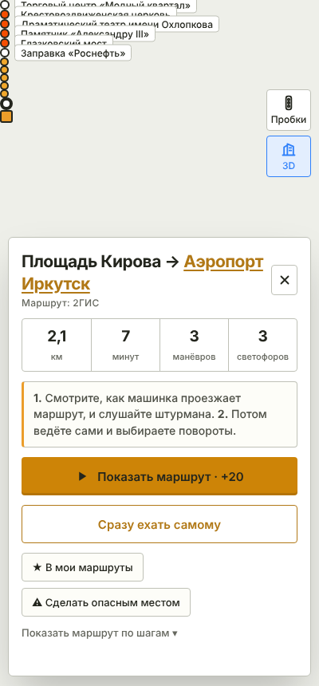
  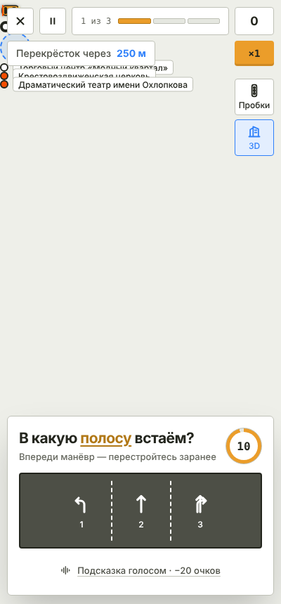
</p>

---

## Содержание
- [Возможности](#возможности)
- [Скриншоты](#скриншоты)
- [Как запустить](#как-запустить)
- [Ключи: голос и карты](#ключи-голос-и-карты)
- [Панель автошкол](#панель-автошкол)
- [Docker: отправить друзьям](#docker-отправить-друзьям)
- [Как устроен проект](#как-устроен-проект)
- [Откуда данные](#откуда-данные)

---

## Возможности

### Маршруты
- **Показ маршрута.** Машинка сама проезжает путь, штурман проговаривает манёвры, светофоры, переходы, школы, «лежачих полицейских» и ориентиры города (+20 очков за просмотр).
- **Поездка самому.** Дорога видна только до ближайшего манёвра. Перед перекрёстком — вопрос «Куда едем?», а где известны полосы — «В какую полосу встаём?». 10 секунд на ответ, подсказка голосом стоит очков.
- **Очки, звёзды, уровни, рейтинг.** Уровни: Новичок → Ученик → Уверенный → Опытный → Штурман → Ас дорог → Легенда Иркутска.
- **Скорость машинки** ×1 / ×1,5 / ×2 / ×3, пауза, выход в меню.
- **Мои маршруты** с напоминанием «Повторим?», **опасные места Иркутска** с советами, **работа над ошибками** по видам манёвров (кольца, левые повороты, развороты, полосы…).
- **Три карты:** обычная (OpenStreetMap), 2ГИС и векторная 2ГИС 3D. Кнопки «Пробки» и «3D-здания».

### Учёба для новичка
- **Дорожные знаки** — 185 карточек (все группы 1–7 ПДД), режим «Главные 40». В каждой карточке: что значит, что делать, ошибка новичка, как запомнить. Озвучка с кнопками «Послушать» и «Стоп», тест на 10 вопросов.
- **Разметка** — 20 главных видов с рисунками и тестом.
- **Светофоры и регулировщик** — 9 сигналов светофора, жесты регулировщика со схемой «что можно с каждой стороны», задачи «вы подъезжаете к регулировщику — что можно?».
- **Если случилось ДТП** — памятка по шагам, кнопки «Позвонить 112» и «Полиция 102».
- **Зима в Иркутске** — гололёд на мостах через Ангару, туман от незамерзающей реки, торможение, занос, что возить с собой.
- **Тренировка дня** — 5 вопросов в день, бонус +20 и серия дней подряд.

### Для автошкол
- Администратор заводит автошколы, преподавателей и учеников.
- Ученик вводит в игре код из 6 символов — и преподаватель видит его очки, маршруты, тесты, ошибки, достижения и проблемные темы.

---

## Скриншоты

### Игра
| Главное меню | Просмотр маршрута | Выбор полосы |
|:---:|:---:|:---:|
|  |  |  |

### Учёба
| Блок «Учёба» | Дорожные знаки | Карточка знака |
|:---:|:---:|:---:|
| 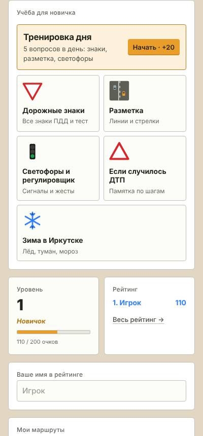 | 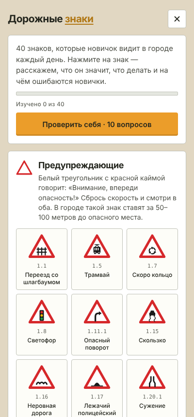 | 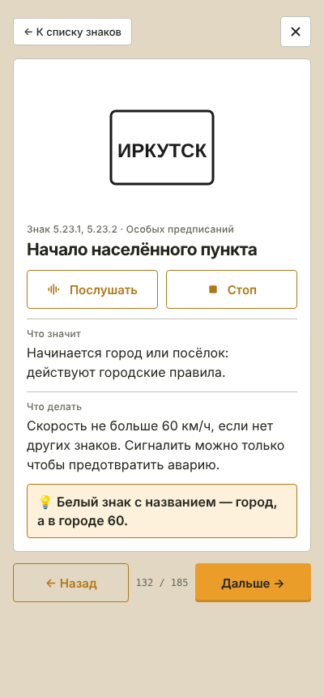 |

| Тест по знакам | Разметка | Регулировщик |
|:---:|:---:|:---:|
| 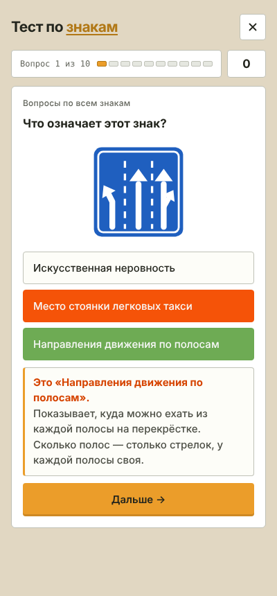 | 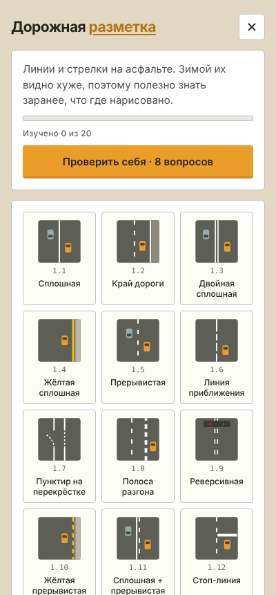 | 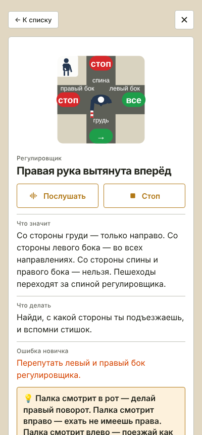 |

| Задача про регулировщика | Памятка при ДТП | Тренировка дня |
|:---:|:---:|:---:|
| 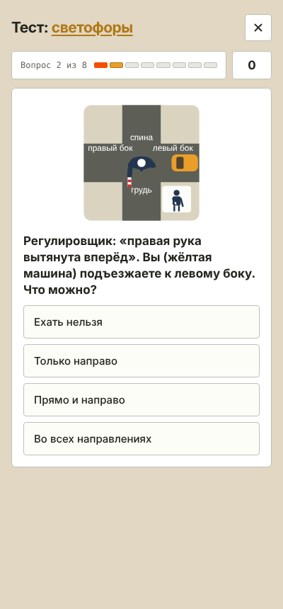 | 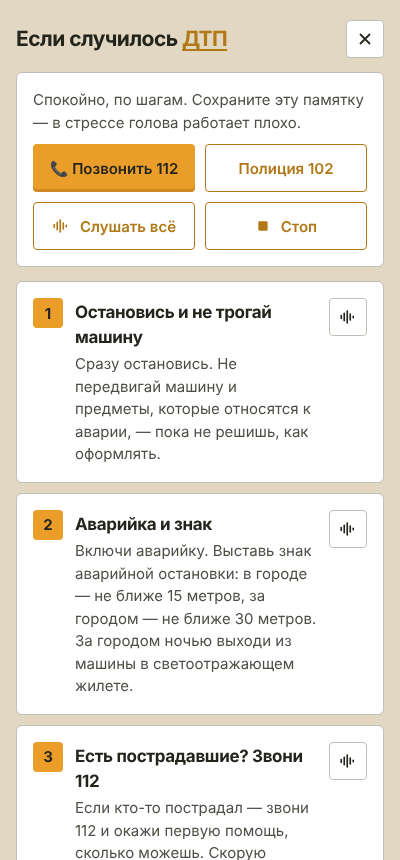 | 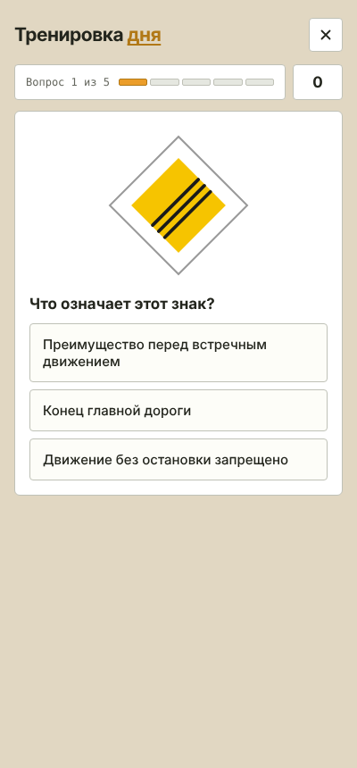 |

### Панель автошкол
| Код ученика в игре | Список автошкол |
|:---:|:---:|
| 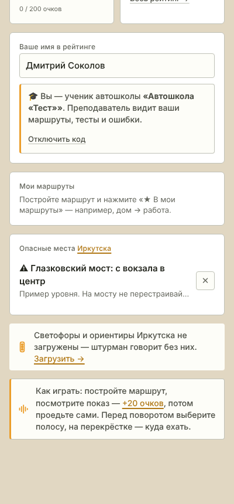 | 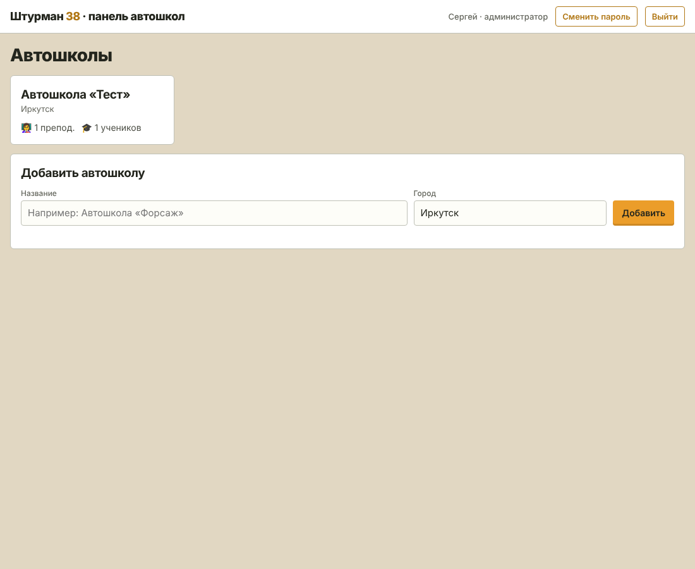 |

**Автошкола: ученики, коды, очки, проблемы**

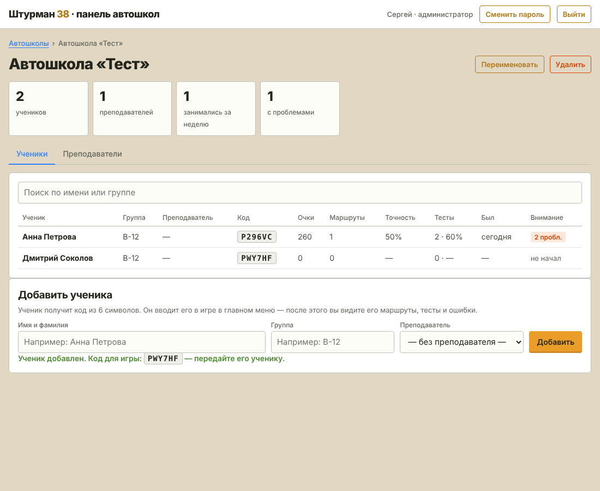

**Карточка ученика: статистика, проблемы, достижения, история занятий**

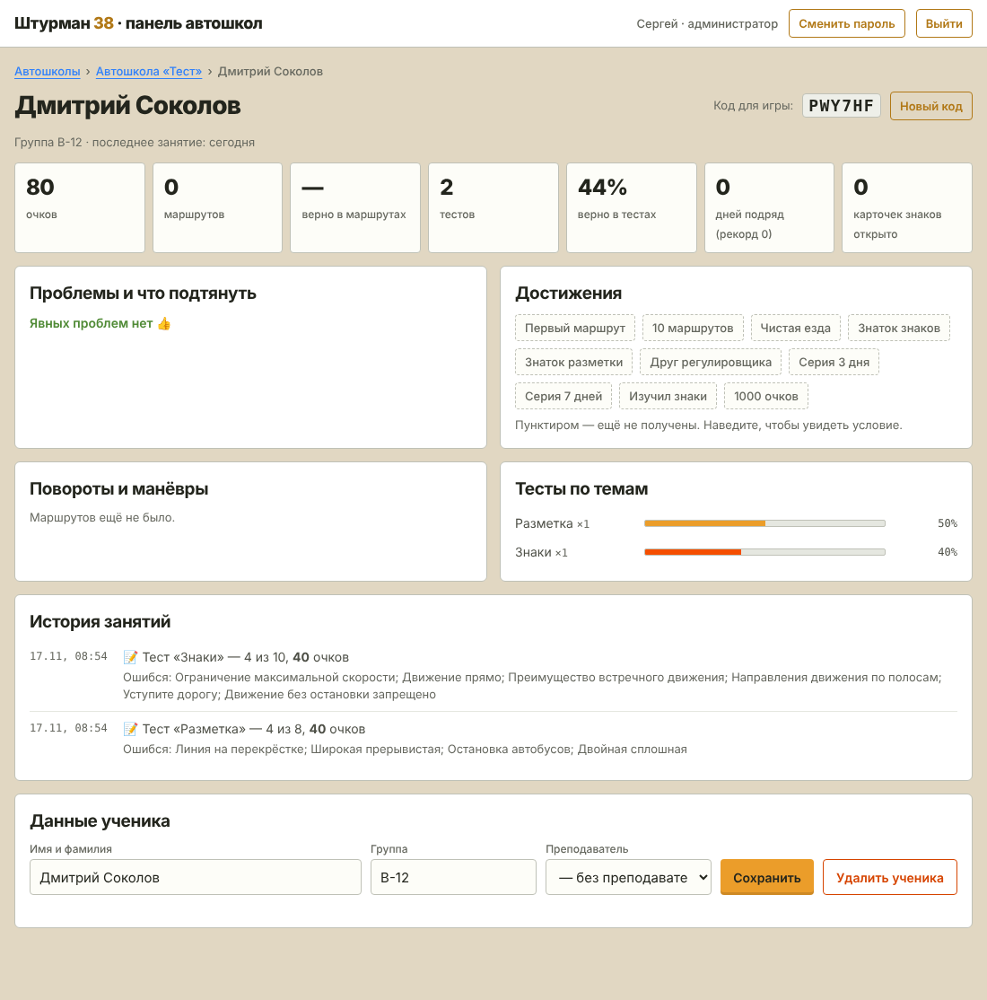

---

## Как запустить

Нужен только **Python 3.10+** (сторонние библиотеки не обязательны).

1. Дважды щёлкните **`run.bat`** (или запустите `app.py` в PyCharm).
2. Откроется браузер: **http://localhost:8765/** — игра.
3. Панель автошкол: **http://localhost:8765/admin**.
4. Первый прототип (карта со списком шагов): http://localhost:8765/proto

Чтобы штурман знал светофоры, переходы и ориентиры: **Настройки → «Загрузить светофоры и ориентиры»** (один раз, сохраняется в `irkutsk_osm.json`).

Игра адаптирована под телефон: откройте адрес компьютера в сети с телефона или выложите на хостинг.

---

## Ключи: голос и карты

Ключи хранятся в `settings_local.json` (в git и в репозиторий **не** попадает). Их можно ввести прямо в игре: **Настройки**.

| Что | Ключ | Без ключа |
|---|---|---|
| Живой голос (Яндекс SpeechKit, LiveTTS: Ирина, Денис, Сергей, Василий…) | ключ API Яндекс Облака | голос Microsoft (edge-tts) или голос браузера |
| Маршруты и карта 2ГИС, пробки, 3D | ключ 2ГИС (Routing / MapGL) | маршруты OSRM, карта OpenStreetMap |

Голос подключается из соседнего проекта **golos** (папка `../golos`). Озвучка кэшируется в `cache_audio/` — за повтор той же фразы деньги не списываются.

---

## Панель автошкол

Адрес: **/admin**.

| Роль | Что может |
|---|---|
| **Администратор** | добавлять и переименовывать автошколы, заводить преподавателей (логин и пароль), добавлять учеников, смотреть всё |
| **Преподаватель** | видит учеников своей автошколы (фильтр «Только мои»), добавляет учеников, смотрит статистику |
| **Ученик** | вводит код из 6 символов в игре (главное меню → «Код ученика автошколы») |

**Что видно по ученику:** очки, число маршрутов, процент верных ответов в маршрутах и тестах, серия дней, сколько знаков изучено; проблемы с советами («Налево без светофора: верно 1 из 3», «Часто путает «Уступите дорогу»», «Не занимался 9 дней»); 10 достижений; статистика по манёврам и темам тестов; история занятий с конкретными ошибками.

**Безопасность:** пароли хранятся только в виде хеша (PBKDF2-SHA256), 5 неверных попыток — блокировка на 10 минут, сессия 12 часов. Пароль администратора меняется кнопкой «Сменить пароль». На хостинге обязательно включите **HTTPS**.

Данные автошкол — в `school.json` (в git не попадает).

---

## Docker: отправить друзьям

1. Установите и запустите **Docker Desktop**.
2. Дважды щёлкните **`docker_build.bat`** — соберётся образ, и в папке `for_friends` появится `shturman38.tar`.
3. Отправьте друзьям папку `for_friends`. Им нужен только Docker Desktop: **`ЗАПУСК.bat`** → игра на http://localhost:8765/, **`СТОП.bat`** — остановить.

Или через compose: `docker compose up -d`. Данные (рейтинг, профили, автошколы) хранятся в томе `shturman38-data`.

---

## Как устроен проект

```
игра навигатор/
├── app.py              — сервер (Python, без фреймворков): маршруты, поиск, озвучка, рейтинг, профили, API
├── navstory.py         — превращает маршрут в «человеческий» рассказ, вопросы и полосы
├── dgis.py             — маршруты и поиск 2ГИС
├── school.py           — панель автошкол: вход, роли, ученики, статистика, достижения
├── game.html           — игра (карта, показ, поездка, меню, настройки)
├── admin.html          — панель автошкол
├── index.html          — первый прототип (/proto)
├── web/
│   ├── signs.js        — раздел «Дорожные знаки»: 185 знаков (SVG), тексты, тест
│   ├── learn.js        — «Учёба»: разметка, светофоры, регулировщик, ДТП, зима, тренировка дня
│   └── favicon…        — значки сайта
├── docs/screenshots/   — скриншоты для этого README
├── Dockerfile, docker-compose.yml, docker_build.bat, for_friends/
└── run.bat             — запуск на Windows
```

**Файлы данных** (создаются сами, в git не попадают): `leaderboard.json` — рейтинг, `profiles.json` — мои маршруты и ошибки, `danger_spots.json` — опасные места, `school.json` — автошколы и ученики, `irkutsk_osm.json` — светофоры и ориентиры, `settings_local.json` — ключи, `cache_audio/` — озвучка.

**Стиль:** светлый «бумажный» (тёплый песочный фон, белые карточки, янтарные кнопки), шрифты Inter Tight, IBM Plex Sans и IBM Plex Mono.

---

## Откуда данные
- **Маршруты:** 2ГИС Routing API, запасной — OSRM (OpenStreetMap).
- **Карты:** OpenStreetMap, 2ГИС, 2ГИС MapGL.
- **Светофоры, переходы, школы, ориентиры:** OpenStreetMap через Overpass.
- **Голос:** Яндекс SpeechKit, Microsoft Edge TTS, голос браузера.
- **Знаки и разметка:** нарисованы вручную в SVG по ГОСТ Р 52290 и Приложениям 1–2 ПДД РФ; рисунки упрощены.

Тексты в разделе «Учёба» написаны простым языком и не заменяют ПДД и занятия в автошколе.

© Штурман 38, Иркутск
